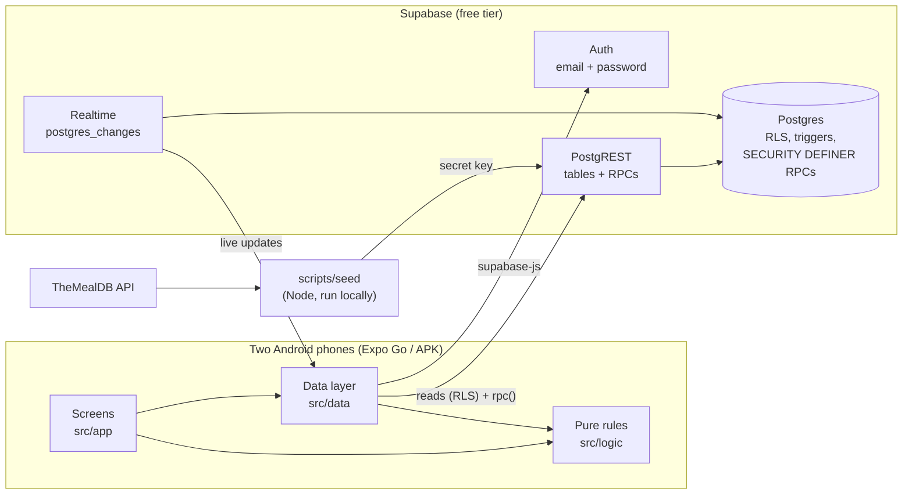
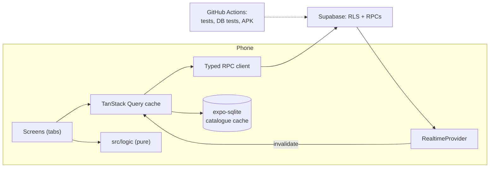

# Architecture

How Foodie Match is built today (bottom-panel navigation and shared filters added 2026-09-28), and how it should evolve. Product rules live in [SPEC.md](SPEC.md), the reasons behind choices in [DECISIONS.md](DECISIONS.md).

## Constraints that shape everything

- **Two users, one couple.** No scale requirements; simplicity beats generality.
- **Free only:** Supabase free tier, local builds, no paid services.
- **Expo Go during development:** only libraries bundled in Expo Go, so no custom native code.
- **Android only.**

## Current architecture

### System overview

There is no custom backend server. The phones talk to Supabase directly. Postgres enforces privacy with row level security (RLS), and every change to shared state goes through a database function (RPC).

### Code layout

| Folder | Role | Rules |
|---|---|---|
| `src/app/` | Expo Router screens (every file is a route) | Thin: layout, local UI state, calls into `src/data` and `src/logic` |
| `src/components/` | Reusable UI: buttons, chips, swipe card, recipe row, match overlay | Colors only from `src/theme/tokens.ts` |
| `src/data/` | Supabase client, auth, React providers and hooks, RPC wrappers, error-code → text | The only place that talks to Supabase |
| `src/logic/` | Business rules as pure functions: normalization, exclusions, deck, match, matches filters, pairing codes, Tonight outcome, Borda, week plan (dates, selection, Generate, edits, leftovers) | No React, no Supabase, no `Date.now()`/`Math.random()`; unit-tested |
| `src/i18n/` | All user-facing strings + `t()` | English only today; Czech = add `cs.ts` |
| `src/theme/` | Color/spacing tokens, WCAG contrast checker | Every text/background pair is contrast-tested |
| `supabase/migrations/` | Schema, RLS, triggers, RPCs | Append-only; never edit an applied migration |
| `supabase/tests/` | Integration tests against local Supabase (Docker) | Real sign-ups, RLS, RPCs, realtime |
| `scripts/` | Recipe import (`seed/themealdb.ts`), `db-push.sh` | Runs on plain Node 24 |
| `data/ingredient-map.json` | Synonyms, hierarchy, keywords, per-recipe fixes | Checked by tests against the real map |

### Data model (Postgres)

- **People:** `profiles` (1:1 with `auth.users`, created by trigger), `couples` (max 2 members, enforced by trigger).
- **Pairing:** `pairing_codes` (6 chars, 10 min, single use), `pairing_invites` (in-app, matched on normalized email).
- **Food:** `recipes` (with estimated `difficulty`), `recipe_ingredients` (name, measure, raw line), `ingredients` (canonical names, single-parent hierarchy), `user_excluded_ingredients` (explicit exclusions only; descendants are implied).
- **Preferences:** `couple_recipe_filters` (max time, difficulties, cuisines; one per couple, both read it, written by RPC), `user_recipe_filters` (the same while unpaired), `user_hidden_recipes` ("Do not eat", readable only by its owner).
- **Activity:** `swipes` (`discover` or `tonight`), `matches` (`via` = `swipe` | `retroactive`, `removed_at`), view `visible_matches` (applies current exclusions at read time).
- **Tonight:** `tonight_sessions` (stage, filters, shortlist, winner), `tonight_participants` (per-stage "done" flags, top picks), `tonight_rankings`.
- **Week plan:** `week_plans` (one per couple and week; stage, this week's 30 picks, leftover setting), `week_plan_slots` (one row per switched-on slot: dish, lock, note, who changed it), `week_plan_members` (re-swipe done, last opened), `week_plan_swipes` (this week's re-swipe), `couple_no_leftovers`. Leftover pairs aren't stored; they're derived from the slots.

### Security model

- **Reads:** RLS lets a user see their own rows plus their partner's (profile, exclusions, discover swipes, tonight swipes in shared sessions), and the couple's matches and sessions. The couple's filters are readable by both partners; "Do not eat" marks are own rows only, and the partner's effect comes from `partner_blocked_recipes()` (recipe ids, no reasons). Recipes and ingredients are readable by any signed-in user; nothing is readable signed out.
- **Writes:** clients may write directly only their own `display_name`, `onboarded` flag, exclusions and "Do not eat" marks; filters go through `set_recipe_filters`. Everything that changes membership, matches or Tonight state is a `SECURITY DEFINER` RPC in `public` that checks `auth.uid()`. Helpers live in the `private` schema, which the API doesn't expose.
- **Errors:** RPCs raise short codes (`code_expired`, `tonight_wrong_stage`); `src/data/errors.ts` maps them to readable text.
- **Secrets:** the app ships only the publishable key. The secret key, access token and DB password stay in `.env` for the seed and deploy scripts.

### Key flows

- **Matching:** `discover_swipe` inserts a swipe; a trigger calls `private.is_match` (SQL twin of `isMatch()` in `src/logic/match.ts`) and inserts `matches` with `via = 'swipe'`. Removing an exclusion or pairing runs `refresh_matches`, which creates `via = 'retroactive'` matches. The match rule therefore exists twice, TS and SQL, and both must change together.
- **Deck:** the phone loads all recipes (~800), all recipe→ingredient pairs (~8k rows, paged), both partners' exclusions and swipes, my filters and marks and the partner's blocked ids, then the pure `buildDeck()` decides the order. Static data is cached for the app session.
- **Navigation:** Expo Router `(tabs)` group with a bottom panel (Swipe · Matches · Recipes · Week plan); tab screens stay mounted. Profile, pairing, Tonight, recipe details, "I don't eat" and the "Do not eat" list are stack screens over the tabs. The tab layout owns the badges (new matches, Tonight and week plan invites) and the first-run redirect.
- **Filters:** one app-wide `RecipeSettingsProvider` holds the filters and my marks, saves optimistically (rollback on error), listens to the couple's filter row over realtime and bumps a `version` after every saved change; Swipe rebuilds its deck on a new version.
- **Live updates:** one app-wide `ProfileProvider` subscribes to `profiles`; `MatchProvider` subscribes to new matches and shows "It's a match!" over any screen. Screens with live data (invites, match list, Tonight) open their own channels with unique names and simply reload on any change.
- **Week plan:** `setup → choosing → generated → accepted`. The phone computes the selection (`pickSelection`), the plan (`generatePlan`) and every edit (`swapSlot`, `moveSlot`…) and saves only changed slots with `plan_write_slots`; the server validates couple, stage, dates and that dishes are shared matches. Realtime on plans/slots/members reloads both phones (debounced, since Generate writes many rows). Plans that are over are deleted on load.
- **Tonight:** a small state machine (`swiping → choosing | shortlisting → ranking | ranking → done`). Each phone computes the next stage with `tonightAdvance()` once both partners have finished, and calls `tonight_advance`, which accepts only the first write for that stage. Both phones may try; exactly one wins.

### Testing and delivery

- **`npm test`** (runs on every commit via `.githooks/pre-commit`): logic unit tests and screen tests (React Native Testing Library, data layer mocked).
- **`npm run test:db`:** integration tests against local Supabase in Docker, covering sign-up, RLS, RPCs, triggers and realtime. Not in the hook, because it needs Docker running.
- **Deploy:** `npm run db:push` applies migrations to the cloud project; `npm run seed` refreshes recipes. The app is served by `npx expo start` to Expo Go; an APK build comes next.

### Known weak spots

1. **Hand-written data hooks:** each loads, caches and subscribes in its own way. Several screens reload whole datasets on any realtime event.
2. **The deck downloads the whole catalogue** on first open (~800 recipes + ~8k ingredient links). That's fine now, but it grows linearly.
3. **The match rule and the filter rule are duplicated** in TS and SQL, guarded only by separate test suites, not by a test that compares them.
4. **Session state lives in the phone's storage** (`expo-sqlite` localStorage): the Supabase session, "last seen matches" and the dismissed Tonight winner. There is no cross-device sync; that's acceptable for the use case.
5. **Tonight RPCs are called through a loosely typed wrapper** (`src/data/tonight.ts`), unlike the rest of the data layer.
6. **No CI:** tests run locally and in the pre-commit hook only.
7. **Week plan rules run on the phone only**; the server checks membership and match rules, not leftover timing. Two phones editing the same slot at once: last write wins.

## Recommended future architecture

Ordered by value for effort. None of these need paid services.

### 1. Query cache instead of hand-written hooks (high value, medium effort)
Adopt **TanStack Query** (pure JS, works in Expo Go):
- Each dataset becomes a query key: `['profile']`, `['matches', coupleId]`, `['tonight', coupleId]`, `['recipes']`.
- Realtime events **invalidate** keys instead of each hook reloading on its own.
- This removes duplicate channels, gives consistent loading/error states, and allows optimistic updates with rollback (exclusions and swipes already do this by hand).
- Keep one realtime subscription per table in a single `RealtimeProvider`.

### 2. Local catalogue cache with a version (high value once recipes grow)
- Add a `catalogue_version` row, bumped by the seed.
- Store recipes, ingredients and recipe→ingredient links in **expo-sqlite** on the phone and refresh only when the version changes. That gives instant start-up and offline browsing.
- If the catalogue reaches thousands of recipes, move deck candidate selection to an SQL function returning a page (e.g. `discover_deck(limit)`), keeping ordering rules in `src/logic` for the final shuffle/interleave.

### 3. One source of truth for the match rule (medium value, low effort)
- Add a **parity test** in `supabase/tests`: generate random ingredient trees, exclusions and likes, then assert that `isMatch()` (TS) equals `private.is_match` (SQL) for every case.
- This keeps the duplication but makes drift impossible to miss.

### 4. Generated, typed RPC client (low effort)
- Wrap every RPC in `src/data/rpc.ts` with types from `database.types.ts` (including Tonight) and delete the loose wrapper.
- Consider a `jsonb` return type convention (`{ ok, data }`) so RPC results don't need casts.

### 5. CI on GitHub Actions (free tier)
- On every push: `npm ci`, typecheck, `npm test`.
- A second job runs `supabase start` and `npm run test:db` (Docker is available on hosted runners).
- Optionally, build the APK on tags and attach it to a GitHub Release, still local tooling, no EAS cloud.

### 6. Server-side hardening (low effort, do before sharing the APK)
- Rate-limit `redeem_pairing_code` attempts per user (a small `attempts` table checked in the RPC).
- Let the inviter cancel an invite; add "delete my account" (cascades are already in place).
- Schedule a cleanup of old used/expired pairing codes (`pg_cron` is available on the free tier).

### 7. Notifications when the app is closed (only if wanted later)
- Requires leaving Expo Go for a development build (`npx expo run:android`) and a free Firebase project for FCM.
- A Supabase Database Webhook or Edge Function (free tier) on `matches` and `tonight_sessions` inserts would call Expo's push service.
- This conflicts with the "Expo Go only" constraint today, so it's a deliberate future step, not a drift.

### 8. More recipe sources and Czech
- **Recipes:** keep `recipes.source` generic. Add an importer per source reusing `normalizeIngredient` and the ingredient map. Own recipes could be a small admin screen gated by a `role` column.
- **Czech:** add `src/i18n/cs.ts` (same shape as `en.ts`) plus Czech synonyms in the ingredient map. Recipe text would need translation or Czech sources.

### Target shape

